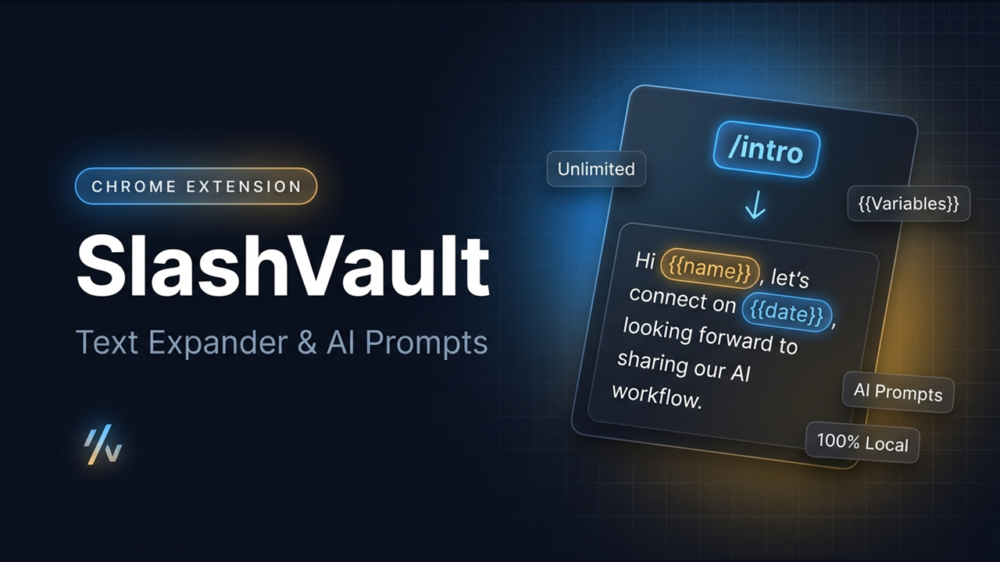

  
  <h1>SlashVault — Local Text Expander &amp; AI Prompt Snippets</h1>
  
<strong>100% 本地端、零月費訂閱的跨網站 `/縮寫` 文字快打與動態變數 `{{變數}}` AI Prompt 片段庫（Text Blaze / Magical 買斷替代品）</strong>

  
Type <code>/shortcuts</code> to expand emails, support replies &amp; AI prompts with dynamic <code>{{variables}}</code> across Gmail, ChatGPT, Claude, Gemini, Slack &amp; Notion — 100% local, no subscription.

  

    <a href="https://eggcellent20.gumroad.com/l/ndisnj"><strong>Get SlashVault Pro ($12 Lifetime)</strong></a> ·
    <a href="https://egg9372000.github.io/slashvault/"><strong>Website</strong></a> ·
    <a href="https://egg9372000.github.io/slashvault/privacy.html"><strong>Privacy Policy</strong></a>
  

  

---

> 🌐 **Language / 語言切換**：[繁體中文](#繁體中文介紹) | [English](#english-overview)

---

## 繁體中文介紹

### 為什麼做 SlashVault？

熱門文字快打工具 **Text Blaze** 免費版只給 20 條片段並要求年費訂閱，**Magical** 則越來越肥重且偏向高價企業訂閱。對客服、業務、人資招募、自由工作者以及每天在 ChatGPT / Claude / Gemini 重複貼常用 Prompt 的使用者來說，只想要一個**輕量、安全、無月費**的工具！

**SlashVault** 特色：
- **跨網站即時 `/縮寫` + 空白鍵展開**：支援一般表單、React/Vue 現代框架與富文字輸入框（Gmail、ChatGPT、Claude、Gemini、Notion、Slack、LinkedIn）。
- **內建日期時間＋動態 `{{變數}}` 填表彈窗（Pro）**：例如設定 `Hi {{客戶名}}, 關於 {{主題}}...`，輸入 `/intro ` 即刻彈出填表框，2 秒自動組裝完整信件或 AI Prompt！
- **絕對隱私安全**：明確忽略所有密碼欄位（`type="password"`），絕不側錄或上傳任何按鍵內容，所有片段皆儲存於本機瀏覽器並支援 JSON 備份還原。

### 免費版 vs. Pro 買斷版

| 功能 | 免費版（Free） | Pro 終身買斷版（$12 一次性） |
|---|:---:|:---:|
| 跨網站 `/縮寫` 即時展開 ＋ `{{date}}` / `{{time}}` | ✅（最多 15 條片段） | ✅ **無限條片段** |
| **動態 `{{自訂變數}}` 互動填表彈窗** | — | ✅ |
| **JSON 一鍵匯出備份與跨裝置還原** | — | ✅ |
| 100% 本地運算、忽略密碼欄、免註冊帳號 | ✅ | ✅ |

---

## English Overview

### Why SlashVault?

Tired of hitting Text Blaze's 20-snippet paywall or paying recurring annual subscriptions just to expand common emails, support replies, and AI prompts?

**SlashVault** is a **100% local, zero-subscription** Chrome & Edge text expander:
- **Instant `/shortcut` + Space Expansion** across Gmail, ChatGPT, Claude, Gemini, Slack, LinkedIn, Notion, and React/Vue forms.
- **Dynamic `{{variable}}` Fill-In Popups (Pro)** plus built-in `{{date}}` and `{{time}}`.
- **Privacy-First**: Explicitly ignores password fields, logs zero keystrokes, and stores everything locally with Pro JSON backup/restore. Read our [Privacy Policy](https://egg9372000.github.io/slashvault/privacy.html).
